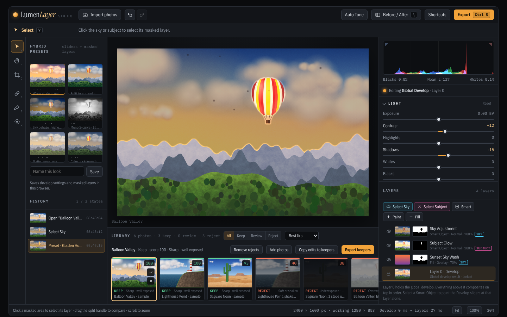

# Lumen Layer Studio

A photo editor that runs entirely in your web browser. It combines two kinds of editing in one window:

- **Develop-style editing**: sliders for light, color, tone curve, color grading and an 8-color HSL mixer, applied to the whole photo.
- **Layer-based retouching**: a stack of layers with blend modes and opacity, automatic Sky and Subject masks, a masking brush, and spot healing.

It also handles a whole shoot. You can import many photos (including camera RAW files), have them sorted automatically into **Keep / Review / Reject**, copy your edits to every keeper, and export them all as one ZIP. Exports can use Instagram sizes, full native resolution and an optional watermark.

Everything is one file, `index.html`. There is nothing to install, no account to create, and your photos never leave your computer.

## Quick start

1. Download this repository: on GitHub click **Code → Download ZIP**, then unzip it.
2. Double-click **`index.html`**. It opens in your web browser.
3. Drag your photos onto the window, or click **Import photos**.

A current version of Chrome, Edge, Firefox or Safari works best. See **[HOW-TO-USE.md](HOW-TO-USE.md)** for the full guide.

## Features

| Area | What you get |
|---|---|
| **Develop** | Exposure, contrast, highlights, shadows, whites, blacks, temperature, tint, vibrance, saturation, dehaze, Auto Tone |
| **Tone & color** | Point tone curve (RGB, R, G, B), 3-way color wheels, 8-channel HSL mixer, live RGB histogram with clipping warnings |
| **Layers** | Smart Object layers with their own develop sliders, pixel layers, fill / gradient / vignette layers, drag-to-reorder stack, 9 blend modes, opacity |
| **Masks** | One-click **Select Sky** and **Select Subject** (automatic detection on your computer, no AI service), masking brush, invert, glowing mask overlay |
| **Retouching** | Spot Healing brush that matches the surrounding light, plus a paint brush |
| **Crop & rotate** | Free or fixed ratios, all Instagram sizes, straighten slider, 90° rotation, flips |
| **Presets** | 6 built-in looks that set sliders *and* build masked layers, plus your own saved looks |
| **History** | Unlimited-feel undo/redo with thumbnail snapshots of every step |
| **Library** | Batch import, automatic quality scoring (focus, exposure, contrast, noise), Keep / Review / Reject sorting, manual flags |
| **AI review** | Optional "Review with Claude" judgement of composition and impact. This works only when the page is opened inside Claude; see the notes below |
| **Copy edits** | Copy any group of settings from one photo to all keepers, each keeping its own undo history |
| **RAW** | CR2, CR3, NEF, ARW, DNG, RAF, ORF, RW2, PEF, SRW and more |
| **Export** | JPEG / PNG / WebP, native resolution up to 16,384 px, Instagram sizes, text or logo watermark, all keepers in one ZIP |

## Things to know

- **Your photos stay on your computer.** Nothing is uploaded anywhere. The page needs an internet connection only for its fonts and one styling library; without one it still works, with plainer fonts.
- **Imported photos are kept only while the page is open.** Export your keepers before you close or reload the tab. Saved presets and watermark settings *are* remembered by your browser.
- **RAW files** are opened through the full-size JPEG preview that cameras store inside every RAW file. A browser cannot process raw sensor data, so you get the camera's own rendering at full resolution, but not the extra highlight and shadow range a dedicated RAW converter would recover.
- **Sky and Subject detection** are simple automatic rules that run on your computer, not a trained AI model. They work well on clear skies and distinct subjects. Use the masking brush (`K`) to fix the rest.
- **"Review with Claude"** only appears when the page is opened as an artifact inside Claude. In a normal browser the on-device scoring still sorts your photos.
- **Very large exports** (40 MP and up) can take several seconds and a lot of memory. On iPhone and iPad, Safari's limit on image size may stop the largest ones.

## Files

| File | Purpose |
|---|---|
| `index.html` | The whole application: open it in a browser |
| `HOW-TO-USE.md` | Step-by-step user guide and keyboard shortcuts |
| `docs/screenshot.png` | Screenshot used in this README |
